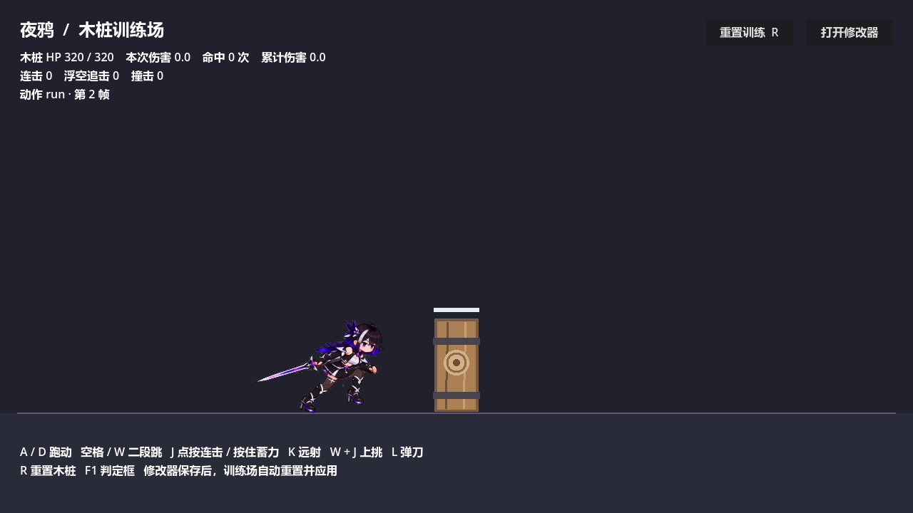
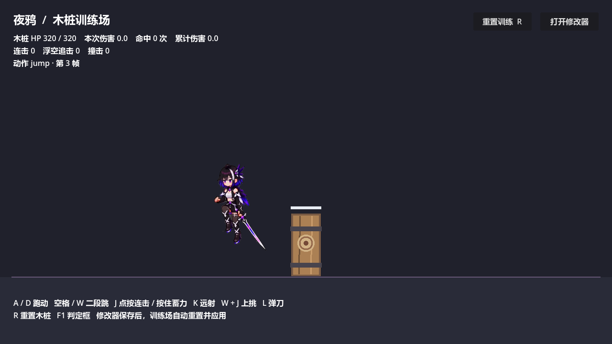

# 前4秒跑跳已接入

之前选定的六段素材不包含跑跳，所以此前游戏仍显示旧动作。这次补入 `mmh3_前4秒_试跑`：107张透明原版帧，没有像素化。该版本比同名旧版少了背景平台和界面干扰；原视频未改动。

游戏中：A/D跑步；空格跳跃，再按一次可二段跳。起跳、下落、落地分别跟随实际状态切换。落地动作短暂播放后继续跑步，不会因为一直按方向就被跳过。攻击动作和战斗参数没有更换。

| 游戏动作 | 视频帧（从1开始） | 播放 |
|---|---|---|
| 跑步 | 67–71 | 16帧/秒，循环；向左自动镜像 |
| 起跳 | 37–42 | 24帧/秒，升空播放，末帧等待 |
| 下落 | 43–46 | 20帧/秒，开始下落时切换 |
| 落地 | 47–50 | 0.15秒，随后回到跑步或待机 |

完整原段可在修改器动作库选择“原版_前4秒完整预览”。实际使用的四段也可以逐帧微调。`jump.fullSequence=false` 启用分段跳跃；缺省仍支持旧版完整跳跃片段。

透明源帧在 `art/game-ready-sequences/locomotion-first4`，运行裁剪副本在 `assets/image/selected-original/locomotion-first4`。裁剪与脚底坐标记录在 `first4-locomotion-import.json`。使用 `tools/art/import_first4_locomotion.py` 可从归档重建。

验证入口：`tests/test_locomotion.gd`；加 `-- --capture` 可通过实际 Godot 渲染保存跑步、起跳、下落和落地截图及状态记录。

本次验证：跑跳12、训练32、战斗反馈52、动画运行时52、前端时序21、修改器联动20，共189项0失败。107张运行裁剪图逐张核对像素；原有攻击片段与战斗参数和上次提交完全一致。截图运行结束仍有引擎既有的2个对象未释放提示，不影响测试结果，未把它计为已修复。

若从视频重新处理：用 ffmpeg 按原帧率抽到工作目录的 `01-raw/frame_%05d.png`，运行 `tools/art/matte_first4_gray.py --work-dir <工作目录>`（需 numpy、OpenCV、Pillow），再给导入脚本传 `--prepared-frames <工作目录>/transparent --source-video <原视频>`。只适用于本次平坦灰背景素材。
