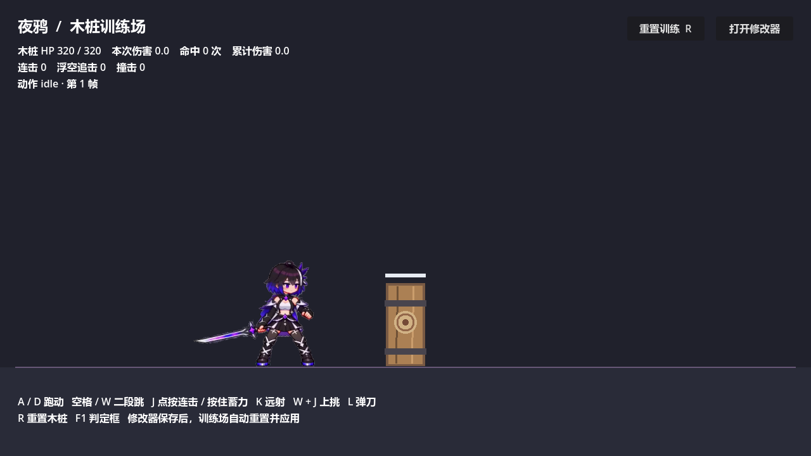
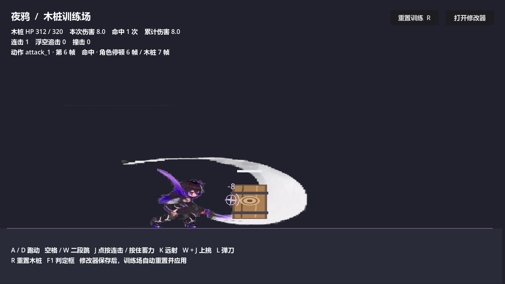

# 修改后的原版动作已接入游戏

这次使用你在 Krita 修改完成的非 3px 原版。打开项目根目录的 `OPEN_GAME.bat` 就可以试。场景仍然只有角色和木桩。

| 操作 | 现在使用的动作 |
|---|---|
| 不按键 | 新原版待机 |
| 连续点按 J | 下切 → 横扫 → 回旋斩 |
| 长按 J，松开 | 蓄力前压重斩 |
| W + J | 回旋挑斩，击飞木桩 |
| 跳起后按 J | 空中挥斩 |
| L | 新格挡起架；木桩不会还击 |
| A / D、空格 | 原有跑步、跳跃，保持可用 |
| K | 原有远射；本批没有专门远射美术 |
| R | 重置木桩和统计 |

角色站立高度约 168 像素，攻击时保持原动作的蹲伏与伸展。出刀、命中、接下一刀按每段动作分别配置。顿帧时角色和刀光一起停，震屏与伤害数字继续生效。

角色和特效分层同步播放，不再叠加旧刀光。待机隐藏 FX 轨里残余的细线。原始图片完整保留；游戏只使用裁掉透明外边的新副本，不进行 3px 像素化。

## 后面自己调

打开 `OPEN_MODIFIER.bat`，在“动作工坊”选择动作和帧。动作列表中的“原版_”片段共 27 段，包含其他普攻、空中动作、冲刺、拔刀、收刀和死亡，可预览或替换招式的对应动作。保存后训练场会重置并应用。

冲刺、拔刀和收刀暂时没有新按键；死亡动画已配置，但木桩不会打死角色。备用片段已经导入，主用片段之外按需加载。

## 实际游戏画面

待机：

第一刀实际打中木桩，触发顿帧、震屏和伤害数字：

本次通过 177 项相关检查；实际渲染检查覆盖待机、三刀、蓄力、上挑、空中攻击、格挡、跑步、跳跃和死亡。素材裁剪与坐标记录在 `selected-original-import.json`，实机取样记录在 `selected-original-visual.json`。
