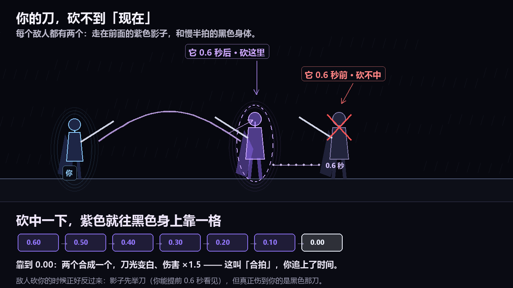

# 玩法提案：**错拍**（Off-Beat）—— DSH 线核心玩法



> 独立于原版雨街战斗。原版是「打现在站在你面前的影子」，这条线是**「打它 0.6 秒后的位置」**。
> 世界观的依据只有一句：**光让时间停住，被挤出的时间沉进影子，所以影子永远比光早一步。**

---

## 0. 一句话

**敌人活在你的未来。你的刀落在它 0.6 秒后的位置上——打「现在」，永远打空。**

---

## 1. 为什么这个世界只该有这一种玩法

《沉影之昼》的设定不是「有个时间暂停技能」，而是一条**物理规则**：

- 昼光把时间按住，人和物停在光里；
- 被挤出来的那份时间沉进影子，影子照常流动；
- 所以**影子里的东西永远比光里的东西先动**（活圣像的倒影提前 0.6 秒出招，就是这个规则的例子）。

原版把这条规则只用在「Boss 的倒影先出招」上，是个点缀。错拍把它变成**整套战斗的坐标系**：
玩家的眼睛看到的是「未来」（影），手要打的是「未来」，而威胁来自「现在」（延迟到达的本体）。
动作游戏里所有直觉都被拧了半圈——这正是它能成为一个独立玩法的原因。

---

## 2. 核心机制：三件东西

### 2.1 影身（Future Self）

每个敌人都有两份：

| | 本体（现在） | 影身（未来） |
|---|---|---|
| 是什么 | 它 0.6 秒前的位置与动作 | 它**此刻**的位置与动作 |
| 长什么样 | 实心黑剪影、落影、能打死你 | 半透明、紫边、很轻，拖一条时间线连到本体 |
| 能不能打 | **打不中**（刀穿过去） | **打这里才算命中** |

- 影身和本体之间连一条细线（时间线），线上有光点从本体流向影身。
- 玩家砍中影身 → 立刻有刀光、数字、闪白；但**伤口在本体身上 0.6 秒后才裂开**（因为它 0.6 秒后才走到那里）。
- 玩家砍中本体 → 刀像划过水面，只有一声空振和一行字：「打的是现在」。
- 敌人的出招也一样：影身先抬手（你能提前 0.6 秒看见），本体 0.6 秒后才真的挥出来——**预警变长了，但你必须躲的是慢半拍的那一刀**。

> 实现上不是「预判算法」，而是把敌人的**逻辑**放在前面跑、**本体**用 0.6 秒前的位置回放。
> 逻辑位置 = 影身，历史位置 = 本体。天然一致，不需要猜。

### 2.2 追拍（Catch-up）

延迟不是固定的惩罚，而是一条**可以被追上的拍子**：

| 连续命中 | 0 | 1 | 2 | 3 | 4 | 5 | 6 |
|---|---|---|---|---|---|---|---|
| 延迟（秒） | 0.60 | 0.50 | 0.40 | 0.30 | 0.20 | 0.10 | **0.00** |

- 每命中影身一次，延迟 −0.1 秒。
- 延迟 = 0 叫**合拍**：影身和本体重合、伤害 ×1.5、刀光从紫变成冷白、音效多一层高频「铮」。
- 2.5 秒不出手、或者被本体打中 → 连击清零、延迟弹回 0.60。

这条曲线是整条线的**爽感引擎**：
新手在 0.6 秒里挣扎，像隔着一层水打人；练熟以后延迟一格一格收，最后「啪」地合上——
**你不是变快了，你是把未来追成了现在。** 这个瞬间比任何数值成长都值钱。

### 2.3 借影（Umbra）

每次斩中影身，会有一片「被斩下来的时间」落进你脚下的影子：**影斑**（上限 5）。

| 花费 | 效果 | 用途 |
|---|---|---|
| 1 影斑 | **预演**：延迟立刻归零 2 秒，不用连击 | 起手爆发、救场 |
| 2 影斑 | **定格**：全场敌人的影身与本体同时钉住 1.2 秒 | 走位、拆火、把一群敌人摆成一条线 |
| 5 影斑（满且不花） | **影我**从你的影子里站起来：用你最近 8 秒的招式，比本体早 0.6 秒 | 风险/收益：打赢掉 3 影斑，打输掉半条命 |

影斑是这条线唯一的资源。它逼玩家在「现在花掉」和「攒着赌一把」之间做选择，
也让「打得越准 → 资源越多 → 打得更准」形成正循环。

---

## 3. 第四件东西：光与影的走位

场景里的灯不是装饰，是**调参器**。

| 站的地方 | 延迟 | 移速 | 影身可见度 |
|---|---|---|---|
| 路灯 / 月光的光池里 | **−0.12 秒**（更好打） | **×0.78**（更慢） | 轮廓被照亮，紫边更清楚 |
| 阴影里 | **+0.12 秒**（更难打） | **×1.15**（更快） | 只有一层淡紫，要靠时间线读 |

于是走位变成「精度 ↔ 速度」的交易：
想打合拍就踩进光里，想拉开距离就退回影里。雨街的灯位本来就是按节奏摆的，这一层不需要新地图。

---

## 4. 一局是怎么打的（30 秒循环）

```
进光 → 读影（它在未来往哪走）
     → 砍影身（命中，延迟 −0.1，影斑 +1）
     → 看本体（0.6 秒后伤口才裂，同时它的刀也才挥出来）
     → 躲本体（不是躲影身！）
     → 连击到 0，合拍，刀光变白，伤害 ×1.5
     → 满影斑 → 预演 / 定格 → 把一波人摆平
     → 连击断，掉回 0.6，重新追
```

**这个循环里没有「背板」**：敌人每一帧都在动，影身每一帧都在变，
玩家读的是「它下一步要去哪」，而不是「第 3 招第 12 帧按 L」。

---

## 5. 敌人：四种「错拍」读法

| 敌人 | 影身的性格 | 玩家要学的事 |
|---|---|---|
| **白蜕·驻时侍从**（基础） | 匀速前进，影身就是本体往前平移 | 「提前量」是什么 |
| **抱钟苦修士**（重甲） | 它自己在抵抗时间：影身会**卡顿、跳格**，外推不准 | 不要盲信影子，等它「钟摆」回位 |
| **绷弦修女**（远程） | 箭先出现在影身手里，0.6 秒后才从本体射出 | 站到「箭的未来落点」上等它 |
| **提炉药师**（范围） | 香炉的烟圈先在影身周围散开 | 砍未来的烟圈，提前引爆 |
| **活圣像·艾德琳**（Boss） | 倒影是实体化的影身，可以站上去 | 跟自己的预知打架 |

第一版试炼只做前两种 + 一个「影我」事件，把规则教清楚。

---

## 6. 精通曲线：三种高手技巧

1. **空挥布阵**：刀挥空会在空气里留 0.6 秒的「待斩刀痕」。算准敌人未来会走过那里，
   就可以先出刀、后命中——**给未来下套**。这是从「追着打」到「等着打」的分水岭。
2. **反向合拍**：故意让连击断在 0.1 秒，用一次「预演」把最后一段补上，
   在 Boss 硬直窗口里打出完整的合拍三连。
3. **定格换位**：定格 1.2 秒不是用来输出的，是用来**把三只敌人摆成一条线**，
   解冻瞬间一刀穿透。影斑花得越晚，收益越高。

---

## 7. 参考与差异（为什么不是抄）

| 参考 | 它做了什么 | 错拍的不同 |
|---|---|---|
| 《Into the Breach》 | 敌人下一步完全可见，回合制规划 | 错拍是**实时**的：未来每一帧都在改写，你要在流动中咬住它 |
| 《武士 零》 | 玩家自己预演路线、慢动作 | 错拍不给你暂停：**是世界在提前播放，你被迫跟上** |
| 《只狼》 | 读招—弹反，考反应 | 错拍把「读招」拆成两半：读影身（未来）、躲本体（现在），两个时间轴 |
| 《Superhot》 | 你不动，时间不动 | 反过来：时间一直在走，**你永远慢半拍** |
| 《Hi-Fi Rush》 | 跟着音乐节拍打 | 拍子是**你自己打出来的**：连击越准，拍子越快，最后合成一拍 |

一句话：**市面上的「预判」都是玩家的技巧，错拍把预判变成了世界的物理规则。**

---

## 8. 失败与代价

- 被本体打中：掉血、连击清零、延迟弹回 0.6，屏幕边缘泛紫（时间从你身上被抽走）。
- 死亡：不是「倒下」，是**你的影子替你继续站着**——黑屏一行字：「你的影子替你活了下去」。
- 满影斑不花：影我出现。它是你自己，所以它也会打影身——**它打你的未来**。

---

## 9. 第一版（`dsh/` 里已经能玩的部分）

- 一个雨街试炼场：3 波，白蜕侍从 + 抱钟苦修士（第二版再加）。
- 影身 / 本体 / 时间线 / 迟到伤口 / 延迟条 / 连击追拍 / 合拍变白 / 影斑 / 预演 / 定格 / 光池走位。
- 全部数值在 `dsh/data/offbeat.json`，改完直接重开就生效。

## 10. 以后可以长出来的东西

- **影我**（满影斑事件）、**空挥刀痕**（布阵）、双人协作（一人打现在、一人打未来）。
- 关卡层面：把「光池」做成可开关的（斩断灯 = 全场退回影里 → 延迟变大但移速变快）。
- Boss：活圣像。倒影实体化 → 玩家可以**站在自己的预知上**去打它。
- PVP：两个人共享同一条时间线，谁先合拍谁先手。

---

*本文件是 DSH 线的玩法准绳；改玩法先改这里，再改 `data/offbeat.json` 和脚本。*
